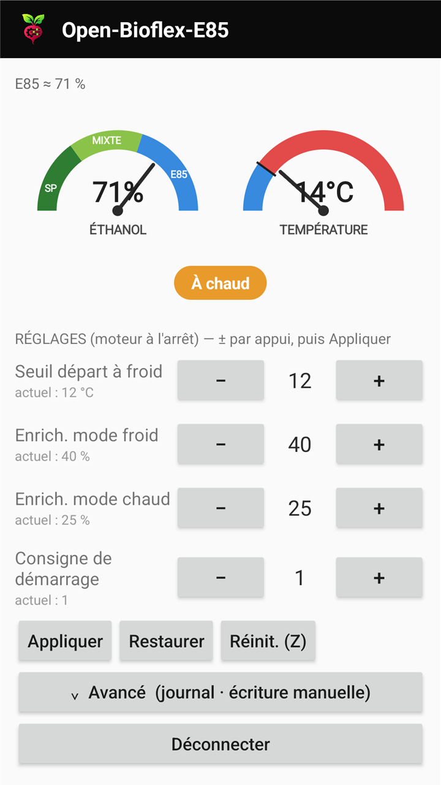

  

<h1 align="center">Open-Bioflex-E85</h1>

  Reverse du boîtier E85 Bioflex Connect (Biomotors) : lecture du taux d'éthanol et réglage de l'injection, sans l'appli officielle.

  <a href="docs/GUIDE-APP.md"><strong>Guide d'utilisation</strong></a>
  ·
  <a href="docs/PROTOCOL.md"><strong>Protocole BLE</strong></a>
  ·
  <a href="https://github.com/YliaLaBaguette/open-bioflex-e85/releases/latest"><strong>Télécharger l'APK</strong></a>

Avec un compte **particulier**, l'appli officielle Biomotors est en **lecture seule**
(éthanol, température, seuil de départ à froid) ; seul un compte **installateur** peut
modifier les réglages. Open-Bioflex-E85 permet de régler son propre boîtier soi-même, sans
passer par le réseau de garages partenaires.

Côté technique, l'application officielle (Flutter) a été décompilée avec
[blutter](https://github.com/worawit/blutter) pour en extraire le protocole Bluetooth du
boîtier, puis Open-Bioflex-E85 a été écrite pour lire ces mêmes données **et** écrire les
réglages. Le dépôt ne redistribue aucun binaire de l'éditeur ni aucun identifiant codé en
dur trouvé dans l'application.

> Destiné à un boîtier que l'on possède, à usage personnel et/ou éducatif.
> Modifier les réglages d'injection d'un véhicule sort du cadre de l'homologation du boîtier
> et relève de la responsabilité de l'utilisateur. Le protocole et les marques « Bioflex » /
> « Biomotors » restent la propriété de leur éditeur.
>
> L'auteur de ce repo n'est pas programmeur ni informaticien, une grande partie du projet a
> été vibe codé et n'a pas été relue en détail par un expert.

## Fonctionnalités

**Application — usage courant**
- Lecture en temps réel du taux d'éthanol (E85) et de la température ; mode chaud/froid déduit (température vs seuil)
- Détection automatique du boîtier, mis en évidence parmi les appareils Bluetooth
- Connexion persistante (lecture continue) et reconnexion automatique
- Réglage du seuil, des enrichissements froid/chaud et de la consigne de démarrage
- Chaque écriture vérifiée par l'écho du boîtier
- Mode aperçu : le tableau de bord avec des données fictives, sans boîtier

**Application — avancé**
- Journal complet exportable (trames hex/ASCII, écritures)
- Écriture de commandes brutes `<lettre><valeur>` et trame décodée champ par champ
- Restauration des valeurs d'origine de la session

**Reverse / technique**
- Protocole BLE décodé (commande `L`, trame `<lettre><valeur>`)
- Écriture des réglages confirmée : le boîtier accepte les commandes standard, sans authentification
- Client de test Python (bleak) pour un PC équipé d'un dongle BLE
- Documentation du protocole, des commandes et de la méthode de réglage

 

> **Testé sur boîtier STD (injection indirecte) uniquement.** Les boîtiers GDI (injection
> directe) ont d'autres commandes d'écriture (mode 1 à 9 / Auto, seuil de détection, mode
> économie d'énergie…), listées dans
> [COMMANDES.md](docs/COMMANDES.md#boîtier-gdi-non-pris-en-charge) et
> **non prises en charge par l'application**.
>
> Toute écriture par Bluetooth désactive le bouton et le potentiomètre internes du boîtier
> (voir le [guide](docs/GUIDE-APP.md)).

## Le dépôt

| Chemin | Contenu |
|---|---|
| [**`docs/GUIDE-APP.md`**](docs/GUIDE-APP.md) | Guide d'utilisation de l'application, avec captures — point de départ. |
| [`docs/PROTOCOL.md`](docs/PROTOCOL.md) | Le protocole BLE décodé (UUID, commande `L`, format de trame). |
| [`docs/COMMANDES.md`](docs/COMMANDES.md) | Les lettres de la trame : confirmées, probables, commandes d'écriture. |
| [`docs/PROCEDURE-INSTALLATION.md`](docs/PROCEDURE-INSTALLATION.md) | Contrôle du véhicule et méthode de réglage à l'OBD. |
| [`app/`](app) | Application Android (Java, sans Gradle) : code source et chaîne de build. |
| [**Releases**](https://github.com/YliaLaBaguette/open-bioflex-e85/releases) | APK prêt à installer, publié à chaque version. |
| [`python-client/`](python-client) | Client de test Python (bleak). |

## Démarrage rapide

Télécharger l'APK depuis la
[dernière release](https://github.com/YliaLaBaguette/open-bioflex-e85/releases/latest) et
l'installer (sources inconnues, puis permission Bluetooth), mettre le contact et fermer
l'application officielle. À l'ouverture, l'application scanne : le
boîtier apparaît en vert, un appui suffit pour que le tableau de bord affiche le taux d'E85
en direct. L'ensemble des détails — réglages, sécurité, mode avancé — figure dans le
**[guide d'utilisation](docs/GUIDE-APP.md)**.

## Aller plus loin

- Compléter les champs restants : les lettres absentes de la trame STD (`pwmHigh`, `delta`…)
  sont cataloguées en « probable » dans `COMMANDES.md` ; un log réel les confirmerait.
- Intégration ESP32 : la lecture (commande `L`, parse du marqueur `O`) se porte facilement
  sur un ESP32 pour un afficheur embarqué.

## Build de l'application

Chaîne sans Gradle : `aapt2` + `javac` (JDK 17) + `d8` + `zipalign` + `apksigner`
(Android build-tools 34), script [`app/build.sh`](app/build.sh). En pratique, la CI GitHub
construit l'APK et le publie dans une
[release](https://github.com/YliaLaBaguette/open-bioflex-e85/releases) à chaque tag `vX.Y.Z`.

## Licence

Code de ce dépôt sous licence [MIT](LICENSE). Les marques « Bioflex » / « Biomotors » et le
protocole du boîtier restent la propriété de leur éditeur ; aucun binaire ni identifiant de
l'application officielle n'est redistribué ici.
