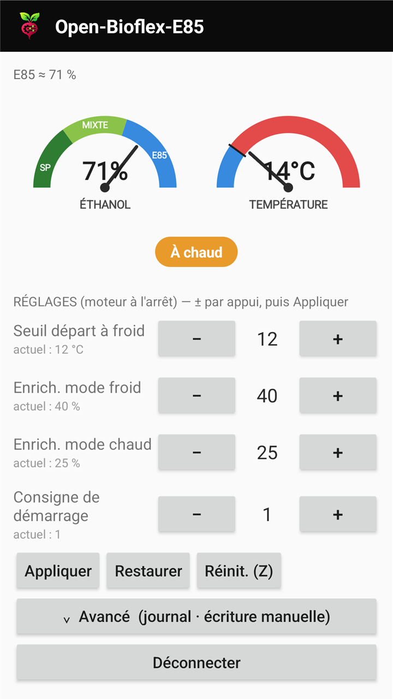

  

<h1 align="center">Open-Bioflex-E85</h1>

  Lecture du taux d'éthanol d'un boîtier E85 Bioflex en Bluetooth, et réglage de l'injection, sans l'appli officielle.

  <a href="https://github.com/YliaLaBaguette/open-bioflex-e85/releases/latest"><strong>Télécharger l'APK</strong></a>
  ·
  <a href="PROTOCOL.md"><strong>Le protocole</strong></a>
  ·
  <a href="COMMANDES.md"><strong>Les commandes</strong></a>

Avec un compte **particulier**, l'appli officielle Biomotors est en **lecture seule**
(éthanol, température, seuil de départ à froid) ; seul un compte **installateur** peut
modifier les réglages. Open-Bioflex-E85 permet de régler son propre boîtier soi-même, sans
passer par le réseau de garages partenaires.

Elle se connecte au boîtier Bioflex (Biomotors) du véhicule et affiche en direct le taux
d'E85 et la température moteur ; elle communique en Bluetooth, en local, sans compte ni
accès internet.

> Destiné à un boîtier que l'on possède, à usage personnel et/ou éducatif. Modifier les
> réglages d'injection d'un véhicule sort du cadre de l'homologation du boîtier et relève de
> la responsabilité de l'utilisateur ; voir la section [Sécurité](#sécurité). Le protocole et
> les marques « Bioflex » / « Biomotors » restent la propriété de leur éditeur.
>
> L'auteur de ce repo n'est pas programmeur ni informaticien, une grande partie du projet a
> été vibe codé et n'a pas été relue en détail par un expert.

## Fonctionnalités

**Usage courant**
- Lecture en temps réel du taux d'éthanol (E85) et de la température ; mode chaud/froid déduit (température vs seuil)
- Détection automatique du boîtier, mis en évidence parmi les appareils Bluetooth
- Connexion persistante (lecture continue) et reconnexion automatique
- Réglage du seuil de départ à froid, des enrichissements et de la consigne de démarrage
- Chaque écriture vérifiée par l'écho du boîtier (✓ confirmé / ⚠ non confirmé)
- Mode aperçu : le tableau de bord avec des données fictives, sans boîtier

**Avancé**
- Journal complet exportable (trames hex/ASCII, écritures)
- Écriture de commandes brutes `<lettre><valeur>` et trame décodée champ par champ
- Restauration des valeurs d'origine de la session

 

## Installation et connexion

L'installation suit celle de toute application hors Play Store : ouvrir l'APK, autoriser les
sources inconnues, puis accorder la permission Bluetooth (« Appareils à proximité » sur
Android 12+) au premier lancement. Sans cette permission, le scan ne renvoie rien.

Le boîtier doit être alimenté (contact mis) et l'application Biomotors officielle fermée :
un seul appareil peut communiquer avec le boîtier à la fois. À l'ouverture, l'application
lance le scan. Le boîtier apparaît en vert en tête de liste, les autres appareils en gris.
Un appui lance la connexion et ouvre le tableau de bord. En cas de perte de liaison,
l'application revient à l'écran de sélection et relance la recherche. Un bouton
**« Aperçu de l'écran »** permet aussi d'ouvrir le tableau de bord avec des données fictives,
sans boîtier (écriture désactivée) — utile pour voir l'interface.

## Utilisation normale

Une fois la connexion établie, le tableau de bord interroge le boîtier environ une fois par
seconde, sans intervention. Les deux jauges affichent l'éthanol et la température ; le badge
indique le mode actif (à froid sous le seuil, à chaud au-dessus).

La section Réglages donne accès à quatre valeurs, ajustables au bouton −/+ (un appui par pas :
5 % pour les enrichissements, 1 pour le seuil et la consigne) :

| Réglage | Rôle |
|---|---|
| Seuil départ à froid | température (°C) de bascule froid ↔ chaud |
| Enrichissement mode froid | surplus de carburant (%) injecté moteur froid |
| Enrichissement mode chaud | surplus de carburant (%) injecté moteur chaud |
| Consigne de démarrage | ce que fait le mode froid : 1 (enrichissement à froid seul) ou 2 (pré-pulvérisation + sur-enrichissement des premières injections) — le bouton « ? » en détaille le fonctionnement |

La valeur « actuel » provient du boîtier. Les enrichissements se règlent **par paliers de
5 %** (0, 5, 10… 50) : le boîtier n'accepte que ces valeurs. Ils sont bornés à 0–50 % par
l'application (garde-fou : le potentiomètre du boîtier va jusqu'à 70 %) ; le seuil de départ à
froid est laissé libre. *Appliquer* (en bas du panneau) affiche le récapitulatif
*ancienne → nouvelle* avant d'écrire, puis **vérifie chaque écriture** en comparant l'écho
renvoyé par le boîtier à la commande envoyée (✓ confirmé / ⚠ non confirmé). Le retour arrière
*Restaurer* (valeurs d'origine de la session) se trouve dans la section **Avancé**.

> ⚠️ **Écrire un réglage désactive le bouton et le potentiomètre du boîtier.** D'après le
> livret Biomotors, dès qu'un réglage est écrit par Bluetooth, les commandes physiques
> internes (bouton poussoir et potentiomètre) ne répondent plus : tout se règle ensuite par
> application. Les réactiver passe par une procédure Biomotors non publiée.

**L'enrichissement à chaud n'est pas une valeur fixe.** Le boîtier le calcule lui-même selon
le taux d'éthanol mesuré : environ 28 % à 65 % d'éthanol, 30 % à 70 %, 35 % à 80 %, 37 % à
85 % ; sous ~20 % d'éthanol il est nul (boîtier inactif, LED bleue fixe). Le réglage
« mode chaud » sert à décaler cette courbe ; l'appli officielle procède par paliers de 5 %.
Le bon réglage se vérifie à l'OBD : la somme des corrections de mélange court terme + long
terme doit revenir aux valeurs relevées avant la pose (voir
[PROCEDURE-INSTALLATION.md](PROCEDURE-INSTALLATION.md)). Plutôt que d'abaisser la valeur sans
visibilité, procéder ainsi, par petits pas.

L'**auto-apprentissage** évoqué dans l'appli officielle est une fonction des boîtiers
**GDI** (injection directe), déclenchée par le mode « Auto » : il n'existe pas sur un
boîtier STD (voir [COMMANDES.md](COMMANDES.md#auto-apprentissage-gdi)).

**Consigne de démarrage (`M`).** Le champ `M` vaut 1 ou 2 : c'est la consigne de départ à
froid (« Cons 1 » / « Cons 2 » dans l'appli officielle).
- Le **seuil** `S` dit *quand* le mode froid s'applique, la **consigne** `M` dit *ce qu'il
  fait*. Chacun s'écrit par sa propre commande ; le boîtier accepte consigne 1 avec un seuil
  personnalisé (l'appli officielle le fait).
- **Consigne 1** (usine) : enrichissement froid réglé seul ; seuil conseillé ~12–15 °C.
- **Consigne 2** (cas difficiles) : seuil conseillé **30 °C**, **pré-pulvérisation** dès la
  mise du contact, environ **+80 % sur les 150 premières injections**. Elle exige que le
  boîtier soit alimenté en **+12 V après contact** (pas en + permanent). À réserver aux
  véhicules qui démarrent mal en consigne 1 malgré tous les réglages : un excès
  d'enrichissement à froid dilue l'huile.
- Lecture et écriture de `M` confirmées : l'appli officielle affiche consigne 2 quand la trame
  donne `M2`, et écrit `M1` / `M2` (capture de ses échanges Bluetooth).

Détail dans [COMMANDES.md](COMMANDES.md#consigne-de-démarrage-m--1-ou-2).

### Points à surveiller

- **Relire le seuil après un changement de consigne** : dans un relevé, écrire la consigne
  seule a ramené le seuil à 12 °C. Le réécrire ensuite si besoin.
- **Consigne qui passe à 2 sans action volontaire** : comportement observé sur un véhicule,
  cause en cours d'analyse. Vérifier la consigne affichée après chaque série de réglages ; le
  journal (Avancé → *Partager log*) permet de retrouver l'écriture en cause.

## Utilisation avancée

Le bouton ⌄ Avancé déplie les outils d'exploration.

Le journal enregistre l'ensemble des échanges — scan, connexion, trames en hex et ASCII,
écritures — et *Partager log* l'exporte dans *Téléchargements*. L'écriture manuelle envoie
une commande brute `<lettre><valeur>`. La liste *Champs lus* présente la trame décodée champ
par champ ; un appui réécrit la valeur courante, sans la modifier.

Sur un boîtier STD, la trame compte six champs. Les quatre premiers sont confirmés
(recoupés avec l'appli officielle ou vérifiés en écriture), les deux derniers nommés
d'après le modèle décompilé :

| Lettre | Sens | Statut |
|---|---|---|
| `O` | % éthanol | confirmé |
| `T` | température °C | confirmé |
| `S` | seuil départ à froid °C | confirmé |
| `M` | consigne de démarrage (1 ou 2) — **pas** le mode froid/chaud | confirmé |
| `F` | enrichissement froid % | confirmé (modèle) |
| `C` | enrichissement chaud % (suit le taux d'éthanol) | confirmé (modèle) |

**Boîtier STD uniquement.** Les essais ont été faits sur un boîtier STD (injection
indirecte). Les boîtiers GDI (injection directe) ont d'autres réglages — mode 1 à 9 / Auto,
seuil de détection, mode économie d'énergie… — donc d'autres commandes d'écriture,
listées dans [COMMANDES.md](COMMANDES.md#boîtier-gdi-non-pris-en-charge) et
**non prises en charge par l'application**.

Réserves : le décodeur reconnaît une quinzaine d'autres lettres
(`V A H I Y X N R D K J U W…`) correspondant à des champs absents de la trame STD
(`pwmHigh`, `delta`…), dont la correspondance est probable mais non vérifiée (voir
[COMMANDES.md](COMMANDES.md)) ; certaines unités sont déduites ; le nombre de cylindres ne
figure pas dans la trame. En cas de doute, comparer la trame brute du journal à l'affichage
de l'appli officielle.

## Sécurité

Le **seuil et l'enrichissement à froid**, ainsi que la consigne de démarrage, se modifient
**moteur coupé, contact mis**. L'**enrichissement à chaud** peut, lui, se régler **moteur
tournant**, idéalement avec un lecteur OBD branché pour suivre en direct les corrections de
mélange (court terme / long terme) et vérifier l'effet de chaque pas. L'E85 consomme davantage
que le SP95 (environ +25 %), ce qu'aucun réglage ne compense. Un enrichissement trop faible
appauvrit le mélange — cliquetis, à-coups, perte de puissance, risque de casse — et la trame
ne contient pas les corrections de la sonde : l'appauvrissement n'est donc pas directement
visible. Procéder par petits pas, un réglage à la fois. Le snapshot et *Restaurer* offrent un
retour arrière, sans dispenser de prudence. Modifier l'injection peut par ailleurs sortir des
conditions d'homologation.
